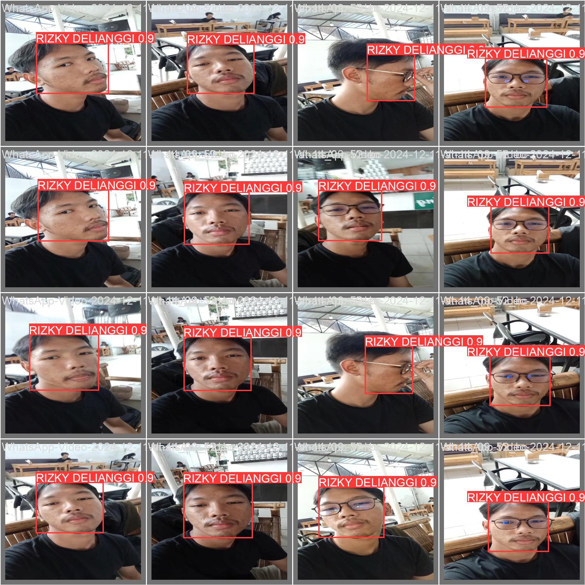

# Face Recognition with YOLOv5

A single-person face recognition experiment: **YOLOv5s fine-tuned with transfer learning** to find one specific face (mine) in images, video or a live webcam stream and label it by name. It shows how a general object detector can be adapted to recognise an individual from a modest set of phone-video frames.


## Results

Validation frames with predictions (`hasil.jpg`): the model finds and labels the face across angles, with and without glasses.



Two short demo recordings of detection runs are in `Program/runs/detect/exp/` and `exp2/`.

> **Scope.** The model has a single class, so it detects *a face that looks like the trained person*; it is not a general face-identification system and has not been evaluated against other people's faces.

## Repository layout

```text
├── hasil.jpg                 # Validation predictions
└── Program/                  # YOLOv5 code base
    ├── rizkydelianggi.pt     # Trained single-class face model
    ├── yolov5s.pt            # Pre-trained base weights (also as TorchScript)
    ├── detect.py · train.py · val.py · export.py
    ├── runs/detect/          # Demo outputs
    ├── models/ · utils/ · data/
    └── requirements.txt
```

## Getting started

```bash
git clone https://github.com/rzkydell/FaceRecognition.git
cd FaceRecognition/Program
pip install -r requirements.txt

# webcam
python detect.py --weights rizkydelianggi.pt --source 0
```

Results are saved to `runs/detect/exp*`. The training images are not included in this repository.

## Credits and license

Built on [Ultralytics YOLOv5](https://github.com/ultralytics/yolov5), which is licensed under AGPL-3.0; the bundled YOLOv5 code keeps that license.

## Author

**Rizky Delianngi** · [Portfolio](https://rzkydell.vercel.app/en#research) · [GitHub](https://github.com/rzkydell)

<details>
<summary>Ringkasan (Bahasa Indonesia)</summary>

Eksperimen pengenalan wajah satu orang dengan YOLOv5s yang dilatih ulang (*transfer learning*): model mendeteksi dan memberi label nama pada wajah pemilik di gambar, video, atau webcam. Model hanya punya satu kelas, jadi bukan sistem identifikasi wajah umum.

</details>
